# 2026-11-16 ~ 11-19 비카 도킹 — 계획·구현·변경·검증

비카가 충전 도크에 스스로 들어가 쉬고, 관리자 앱에서 부르면 나와서 다시 일하는 기능이다. 라이다로 V자 모양
도크를 찾아 정면으로 들어가고(전진 도킹), 나올 때는 뒤 초음파로 뒤를 확인하며 물러난 뒤 180° 돌아선다.
11-19 에 세 저장소(ROS·앱·음성) 모두 운영 브랜치 `after_feedback_waiting` 에 합쳤고, 평소 주행 묶음(systemd 유닛)
으로 도킹·나오기를 확인했다. 충전 접점과 충전 감지는 다음 단계다.

- 보기 좋게 정리한 판: 아티팩트 '비카 도킹 개발' https://claude.ai/artifact/2HTPHUmLDESCCgiLBNZJ5y
- 원자료 전체: 젯슨 `~/vica_data/docking_plan/README.md`(회차별 표·장애 기록), 회차 폴더 `field_2026-11-17·18·19*/`
- 이 저장소에 함께 넣은 것: 그림 `docs/images/docking/fig1~4`, 결과 표 `docs/docking/dock_results.csv`·`summary_tables.md`,
  만드는 스크립트 `docs/docking/extract_results.py`·`make_figures.py`

## 1. 동작

들어가기(앱 '도킹 시작' → "도킹 위치로 복귀합니다")

1. 멀면 Nav2 로 도크 앞 1 m(준비 위치)까지 간다. 준비 위치 바로 옆(좌우 0.25 m, 앞뒤 −0.60~+0.30 m)이면 제자리에서
   도크 쪽으로 돈다(Nav2 는 0.16 m 떨어진 목표에 경로를 못 그렸다). 도크 구역 안이면 바로 들어간다.
2. 라이다로 V자를 5번 연속 확인 → 제자리 정렬 → 직진 10 cm/s(마지막 10 cm 는 5 cm/s) → 범퍼~꼭짓점 14 cm 정지.
3. 도킹 완료: 손잡이 LED 상태 6(순초록 (0,255,0) 숨쉬기 8~60 %, 2.4 s).

나오기(앱 '도크에서 나오기', 또는 도크 안에서 원격 주행을 보냄)

1. 뒤 초음파로 0.80 m 안이 비었는지 확인 → 8 cm/s 로 범퍼~꼭짓점 85 cm 까지 후진(약 71 cm).
2. 제자리 180° 회전(0.30 rad/s, 가까운 물체가 있으면 0.12 rad/s) → 주행 모드. 원격 주행을 보냈으면 그 장소로 출발.

중지·비상정지로 멈추면 그 자리에 서고 스스로 다시 하지 않는다. 나오다 멈추면 도킹 노드가 기억해 두고(`undock_pending`)
'도크에서 나오기 다시시작'을 누르면 남은 동작만 한다. 남은 회전이 10° 이하면 다 나온 것으로 본다.

도킹 중·도크 안에서는 '쉬는 중'이다. "비카야" → "비카가 밥 먹고 있어요. 밥 먹을때는 개도 안 건드린다는 속담이 있죠"만
하고 듣지 않는다. 나오다 멈춘 상태는 "비카가 아직 밥을 덜 먹었어요. 조금만 기다려주세요". 사람 접근·호출 방향 회전은 하지 않는다.

## 2. 사용자 결정

| 날짜 | 결정 |
| --- | --- |
| 11-16 | 실제 충전 도크(바닥 접점, 허용 1~1.5 cm), 도크 1개, 전진 도킹, 라이다 V자 인식(AprilTag 후순위), 뒤 초음파 확인 후 회전, 도킹 뒤 AMCL 재설정 |
| 11-17 | 1 m 앞에서 정렬 → 직진. 구조물은 그대로, 1 m 안에서만 인식 |
| 11-18 | 도착 14 cm, 해제 85 cm 후진 + 180°, 뒤 초음파 ch5·ch6 상한 0.80 m, 홈·도크 따로(`home.yaml`·`dock.yaml`), 도킹은 앱으로만, 도킹 중 쉬는 중 |
| 11-19 | 좌우 출발 한계 30 cm 유지, LED 순초록, 멘트 3개, 나오다 멈춤 처리, 가려짐 = 막힘 대기, lost 3 s, 도크 위치 지정 3가지, 도킹 중 원격 주행 버튼 숨김 |

## 3. 도크와 로봇

| 항목 | 값 | 출처 |
| --- | --- | --- |
| V자 내각 / 팔 길이 | 120.1~120.5° / 0.199~0.204 m | 11-17 라이다 실측 |
| V자 높이 | 바닥에서 0.35~0.40 m | 구조물 |
| 라이다 | 바닥 0.382 m, 구동축 앞 0.031 m, 720빔 · 0.5°, 약 12 Hz | `VICA.xacro`, `/scan` |
| 범퍼 앞면 | 구동축 앞 0.151 m | `VICA.xacro` |
| V자 인식 거리 | 라이다→꼭짓점 1.32 m 까지 안정, 1.62 m 부터 못 찾음 | 11-17·18 정지 스캔 |
| 준비 위치 | 꼭짓점 앞 1.151 m(범퍼 기준 1.00 m) | `approach.stage_cm` |
| 제자리 회전 여유 | 구동축~V자 팔 끝 0.72 m 이상(손잡이 끝 반경 0.67 + 0.05) | `approach.rot_clear` |

## 4. 구성

| 부분 | 하는 일 | 이름 |
| --- | --- | --- |
| 도킹 노드(새로, C++) | V자 인식·들어가기·나오기·도크 위치 저장, 켜질 때 도크 안이면 AMCL 초기 위치 | 패키지 `vica_docking`, 서비스 `/vica/dock/start·undock·cancel·register·get·delete`(Trigger)·`/vica/dock/set`(SaveHome), 상태 `/vica/dock/state` |
| 미션 매니저 | 앱 요청을 받아 도킹 노드·Nav2 에 시킴, 도크 안 원격 주행은 잡아 두고 먼저 나온 뒤 보냄, 음성·접근 막기 | `/vica/mission/dock_start·dock_undock·dock_cancel`, `dock_flow.py`, `dock_spot.py` |
| 손잡이 | `dialog_state` docked → 상태 6, 뒤·뒷바퀴 옆 초음파 | `/ultrasonic/dock_*`, 펌웨어 `DOCK_R/G/B` |
| 앱 | 원격 주행 탭 도킹 버튼, 지도 설정 '도크 위치' 칸, 실패 팝업 | `dock_position_card.dart`, `dock_dialogs.dart` |
| 음성 | 도킹 멘트 3개 미리 합성 | `mission_phrases.py` |

속도 명령은 Nav2 와 같은 길(`/cmd_vel_req` → Safety → `/cmd_vel_safe` → 모터)이라 비상정지 래치가 그대로 듣는다.
도크 접근 때는 `collision_monitor` 를 거치지 않고(11-16 결정) 아래 안전 장치를 도킹 노드가 직접 한다.

## 5. 안전 장치

| 상황 | 동작 |
| --- | --- |
| 들어가는 길 앞 30 cm 안 물체 | 멈춰 기다림 → 비면 1 s 뒤 재출발 → 30 s 넘으면 실패(blocked) |
| 물체가 V자를 가림 | V자까지의 통로에 점이 있으면 막힘으로 보고 같은 규칙(11-19 상자 실기 뒤 추가) |
| V자만 3 s 넘게 안 보임 | lost → 준비 위치로 물러나 한 번 더 |
| 출발 자리가 정면에서 30 cm · 30° 밖 | 움직이지 않고 out_of_range → 미션이 도크 위치를 다시 읽어 한 번 더 |
| 명령 2 s 에 안 움직임 / 다른 노드 명령 / 비상정지 | no_motion / conflict / 즉시 정지, 자동 재개 없음 |
| 나오기: 출발 전 뒤 0.80 m · 후진 중 남은 거리+0.25 m · 회전 중 초음파 0.25 m 또는 라이다 반경 0.64 m | 멈춰 기다림(회전은 가까우면 천천히) |
| 도크 근처에서 Nav2 제자리 회전 | 미션이 보내지 않음. Nav2 자체 충돌 검사도 거절(11-19 16:35) |

## 6. 도크 위치

`dock.yaml`(지도별 1개)에 V자 꼭짓점과 '도크를 정면으로 보는 방향'만 저장한다.

- 도크 인식해서 저장: 그 순간 AMCL 위치 + 라이다로 잰 도크. 인식되면 저장. 실패는 사유별 팝업(못 찾음·불안정·초기 위치 없음·주행 꺼짐).
- 지도에서 지정: 도크 구조물 → 도크 앞쪽을 차례로 누름. 도크 앞 1 m 미리보기 후 저장.
- 처음 도킹 성공 때 한 번 라이다로 잰 값으로 고쳐 저장('가 본 자리'). 그 뒤로는 도킹할 때 도크 기준으로 AMCL 을 맞춘다.

## 7. 검증

자동 시험(11-19 운영 브랜치 기준): 도킹 gtest 18(합성 스캔 닫힌 고리), 미션 1831(도킹 41 포함, 실패 5개는 도킹과 무관한
기존 것), 손잡이 C++ 21·Python 241, 앱 976(analyze 0), 음성 문구 17.

독립 검토 3번(코드만 읽는 검토): ROS 1차 높음 4·중간 7·낮음 13, 2차 회귀 1·불완전 3, 앱 높음 1·중간 5 — 모두 수리하고 시험 추가.
대표: 도킹 중에 온 미션 주행이 Nav2 로 그대로 나가던 것, V자를 못 본 채 끝나면 '도크 근처' 표시가 내려가던 것,
나온 자리가 제자리 회전 경계에 걸린 회귀, 다른 지도의 도크가 보이던 앱 문제.

실기(11-18 밤 ~ 11-19 오후, 사용자가 일부러 멈춘 회차 제외):

| 항목 | 회수 | 평균 | 표준편차 | 범위 |
| --- | --- | --- | --- | --- |
| 도킹 앞뒤 오차 | 18 | +0.01 cm | 0.07 | −0.16 ~ +0.14 |
| 도킹 좌우 오차 | 18 | −0.57 cm | 0.47 | −1.02 ~ +1.01 |
| 도킹 방향 오차 | 18 | +0.98° | 1.72 | −2.36 ~ +3.04 |
| 들어가기 걸린 시간 | 18 | 15.3 s | 5.2 | 7.9 ~ 25.4 |
| 나오기 후진 거리 | 11 | 71.35 cm | 0.47 | 70.4 ~ 72.2 |
| 나오기 회전각 | 11 | 179.3° | 0.80 | 178.2 ~ 180.5 |
| 나오기 걸린 시간 | 11 | 23.2 s | 2.9 | 21.4 ~ 30.1 |

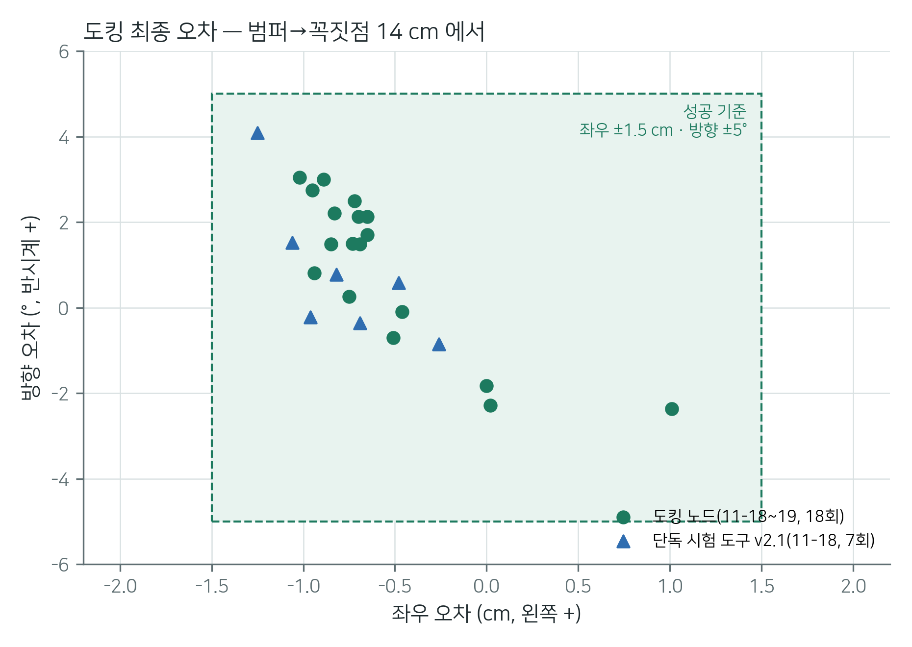
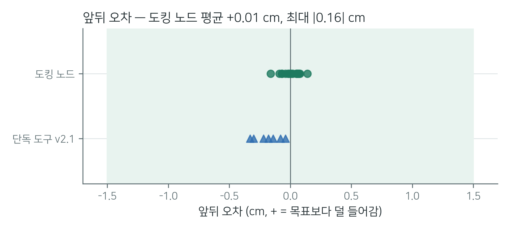
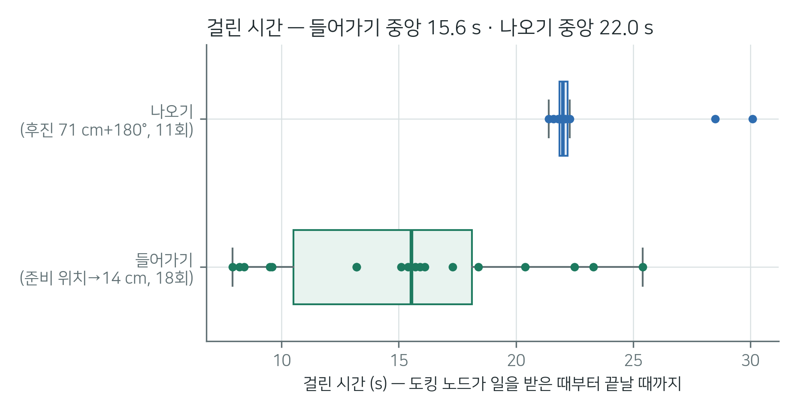
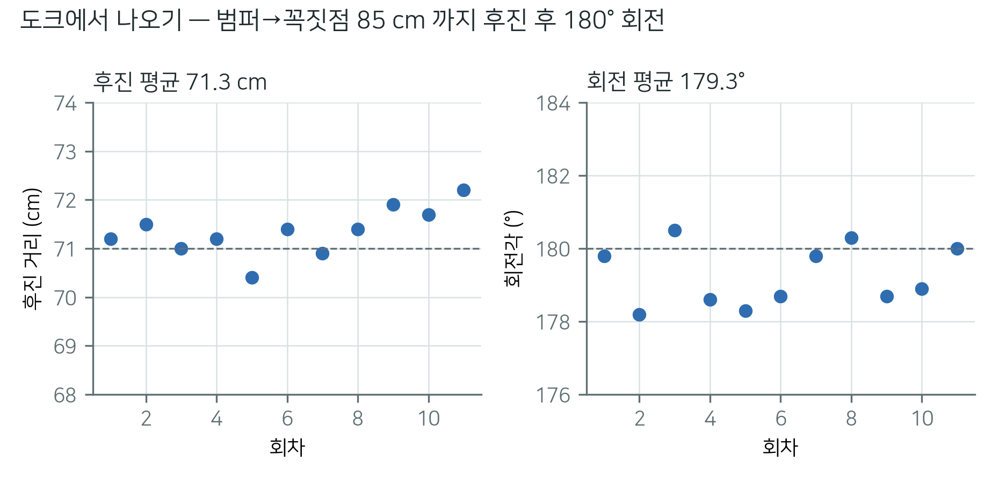

멈춘 회차: 11-18 no_motion(헛판정 → 수리), 11-19 lost(상자 가림 → 막힘 대기로), not_found(도크 밖에서 나오기),
out_of_range(정면에서 벗어난 자리 → 정상 거절), 사용자 중지·비상정지 시험 11번.

## 8. 발견과 남은 일

- 도크를 옮긴 뒤(11-19 오후) 지도에는 옛 구조물이 남아 새 도크 근처에서 AMCL 이 끌린다. 같은 도크에서 인식 저장과 25 s 뒤
  도킹 고쳐 저장이 48.8 cm 달랐다. 도크 근처 지도를 고친 뒤 도킹해서 `AMCL 초기 위치: kept` 를 확인한다.
- 다른 무거운 작업과 주행 기동이 겹쳐 load 62 까지 갔을 때 초기 위치 확인 노드 멈춤·planner TF 수신 끊김·손잡이 비상정지 신호
  끊김이 생겼다. 그 유닛만 다시 띄워 풀었다. 주행 중 무거운 작업을 같이 돌리지 않는다.
- 고칠 것: 들어가는 중 '막혀 기다림'이 상태 토픽·기록에 안 남음, 저장 실패도 로그가 '끝: register · success', 고쳐 저장 기준(AMCL 분산·보정 상한).
- 실기로 안 본 것: 30 s 막힘 실패, 도킹 중 비상정지, 도크 안 "비카야", 충전 접점·감지.

## 9. 변경 기록

| 저장소 | 커밋 | 내용 |
| --- | --- | --- |
| ROS | baa076b · 29101fd · abe4764 · 8003823 | 도킹 노드, 미션 도킹 흐름, 손잡이 LED·뒤 초음파, 운영 브랜치와 합침(운영 = 8003823) |
| 앱 | 508083b · a078e8c | 도킹 버튼·도크 위치 칸·팝업, 운영 앱 브랜치 = a078e8c |
| 음성 | 733c476 · f3cbe0e | 도킹 멘트 미리 합성, 운영 음성 브랜치에 합침 |
| 펌웨어 | 나노 업로드 | 상태 6 순초록 숨쉬기 |

dev 에는 운영 브랜치를 dev 로 합칠 때 같이 들어간다(운영 브랜치에 다른 작업 커밋이 섞여 있어 도킹만 따로 넣지 않는다).

## 10. 근거 시험 자료 — 기능을 이렇게 정한 이유(11-19 추가)

도킹 노드를 만들기 전 11-17·18 시험 도구로 확인한 자료와, 11-19 실기에서 규칙을 바꾸게 한 장면이다.
원자료 요약 표 `docs/docking/approach_runs_1117.csv`·`approach_runs_1118.csv`·`undock_trials_1118.csv`, 그림 스크립트 `docs/docking/make_figures2.py`.

| 그림 | 보여 주는 것 | 정한 것 |
| --- | --- | --- |
| 5 V자 구조물 실측 | 정지 스캔 80장, 내각 120.5°(±0.22), 팔 0.203·0.199 m, 직선 잔차 ≤0.72 mm | 두 팔을 직선으로 맞춰 꼭짓점·축을 구함 |
| 6 거리별 인식률 | 라이다→꼭짓점 1.13 m 70/80, 1.32 m 안정, 1.62 m 부터 0/80 | 도크 앞 1 m 까지 Nav2, 그 뒤 V자로 |
| 7 접근 궤적 | 출발 좌우 −48~+31 cm·방향 ±30° → 30 cm 안 7회 모두 정면 14 cm 로 모임, −48 cm 는 V자를 놓쳐 중단 | 좌우 출발 한계 30 cm |
| 8 출발 자리와 도착 오차 | ±30 cm·±30° 안 7/7, 좌우 ≤1.25 cm, 방향 ≤4.1° | 성공 기준 좌우 1.5 cm·방향 5° |
| 9 한 번의 접근 시간 흐름 | 대기 → 정렬 2 s → 직진 10 cm/s(마지막 10 cm 5 cm/s) → 정지 뒤 30 스캔 평균 | 단계 구성 |
| 10 넘침과 앞당김 | 정지 명령 뒤 1.20~1.46 cm 더 감(평균 1.34) → 앞당긴 뒤 18회 −0.16~+0.14 cm | 정지 앞당김 |
| 11 나오기 10회 | 80 cm 에서는 회전 중 뒤 23~24 cm(기준 25 cm 에 걸림), 85 cm 에서는 25~28 cm | 85 cm 까지 후진 |
| 12 상자 가림 장면 | 30 cm 감시 구역 밖 상자가 V자를 가려 lost | 가려짐 = 막힘 대기, lost 3 s |
| 13 지도 위 도크 위치 | 도크를 옮긴 뒤 저장 값들이 0.5~1 m 어긋나고 둘은 벽선 너머 | 도크 근처 지도 고치기 필요 |

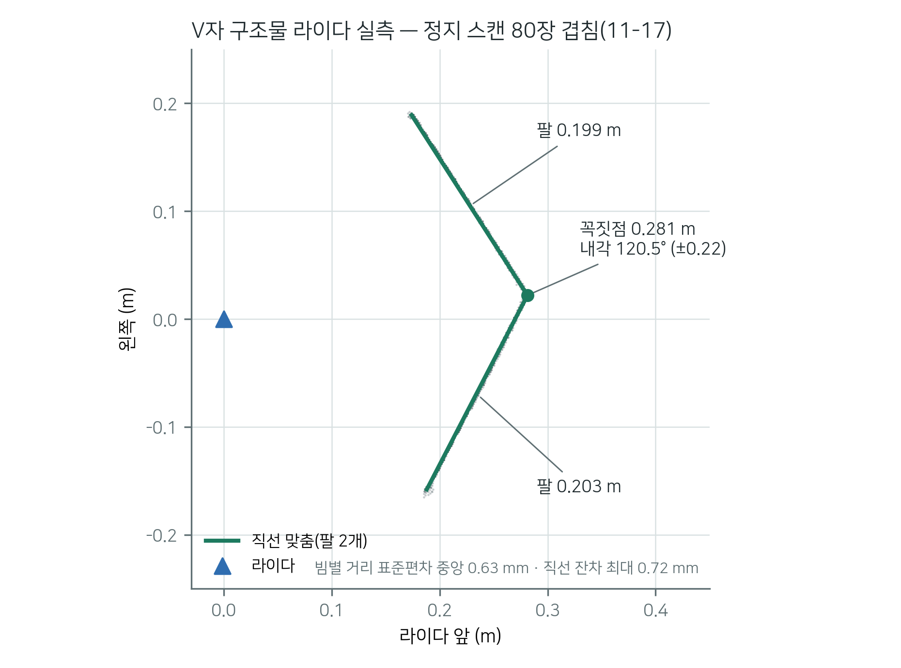
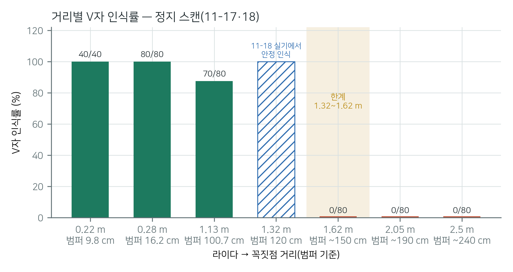
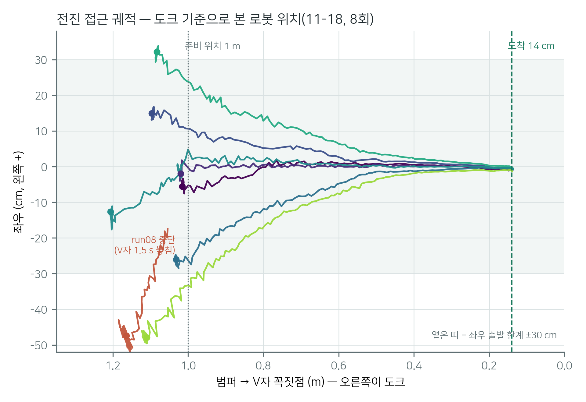
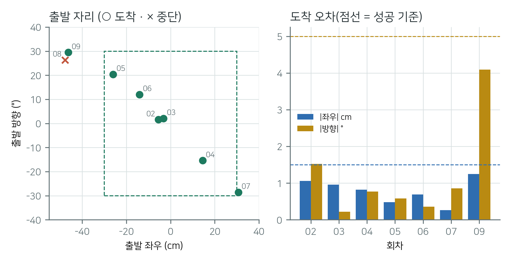
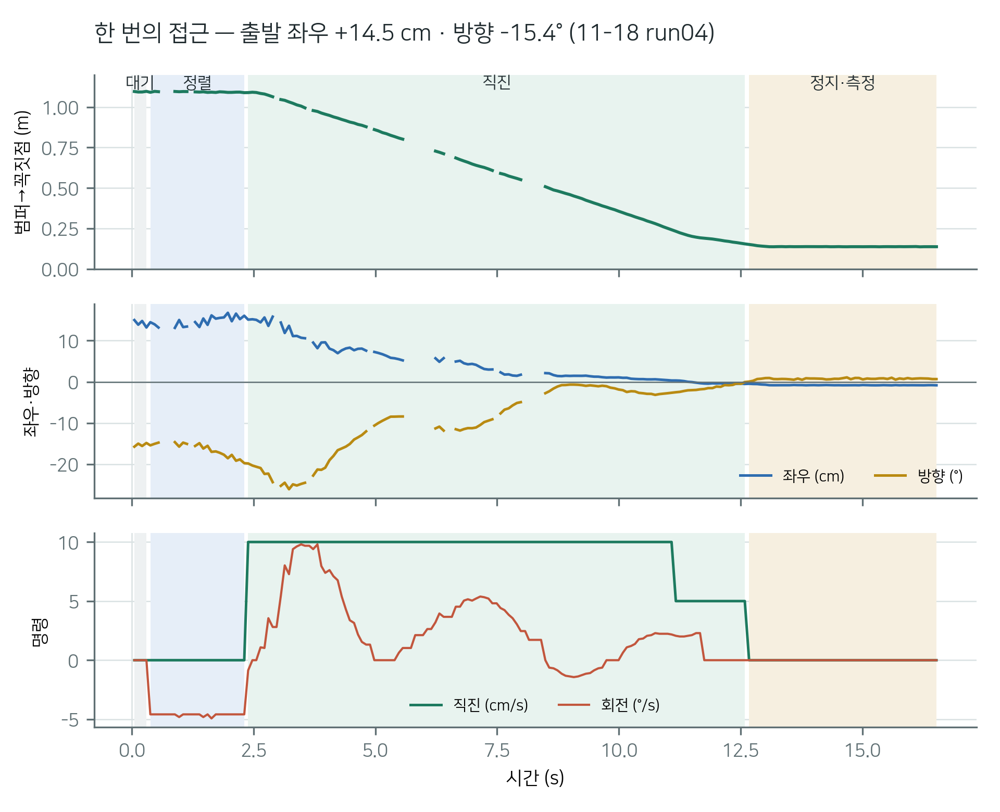
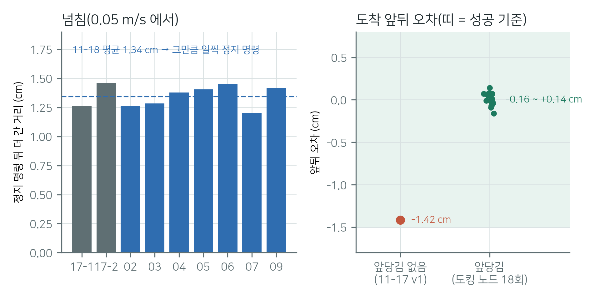
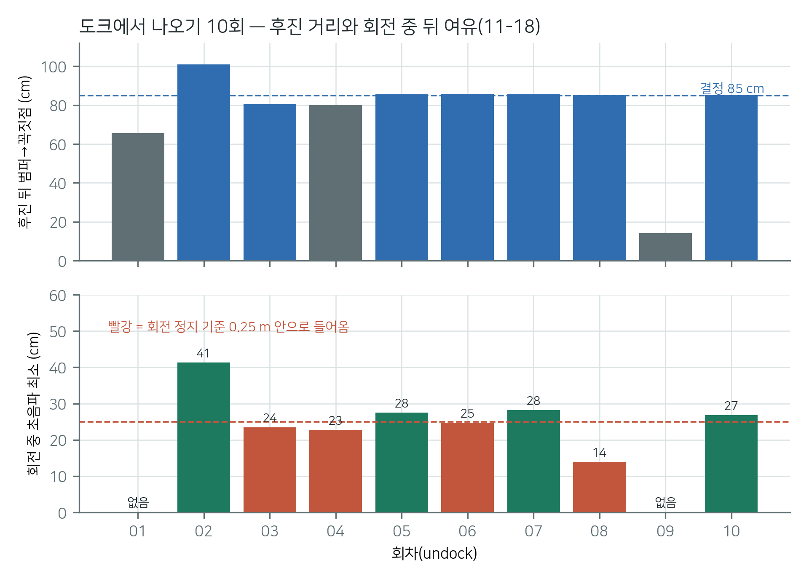
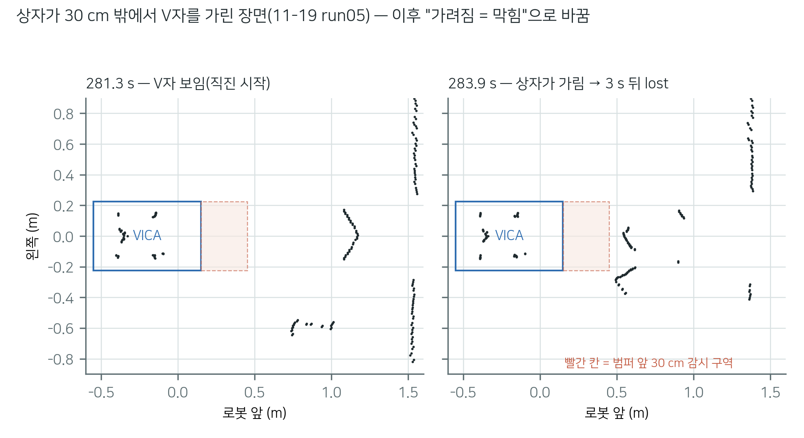
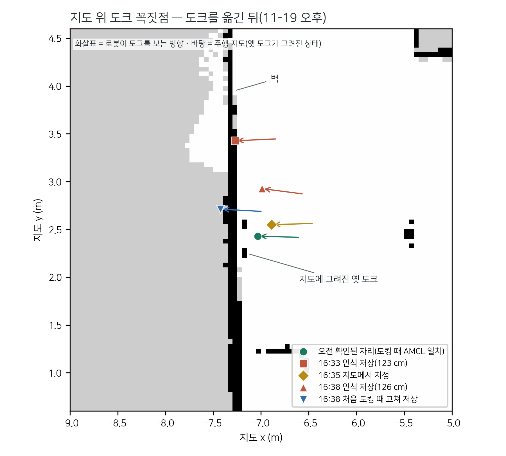
