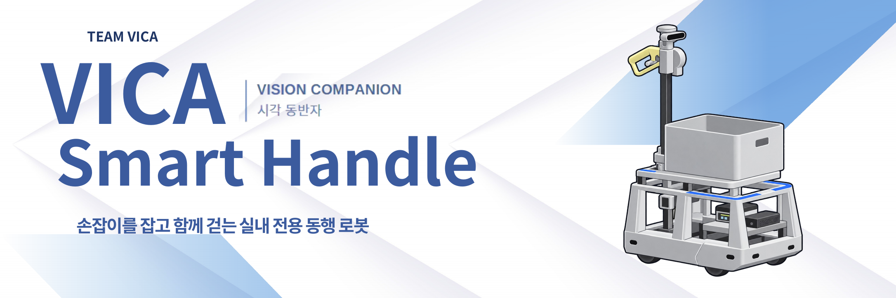
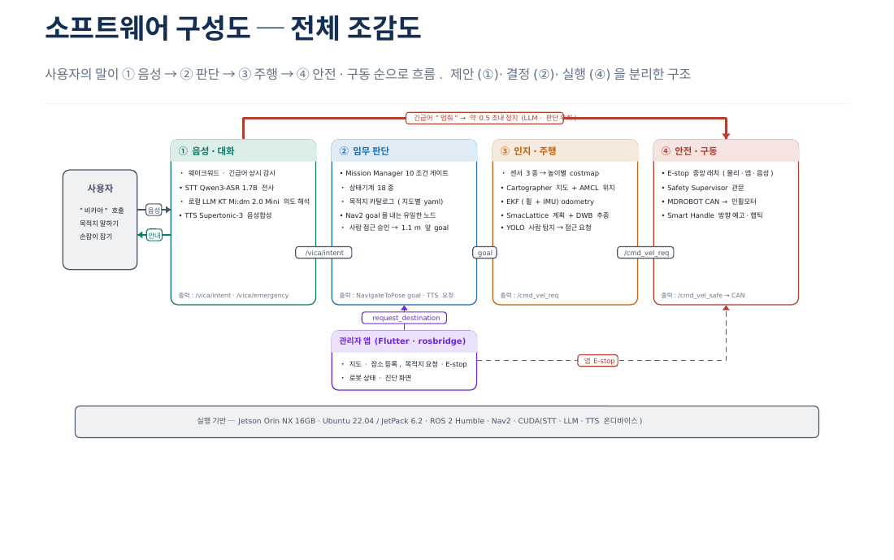
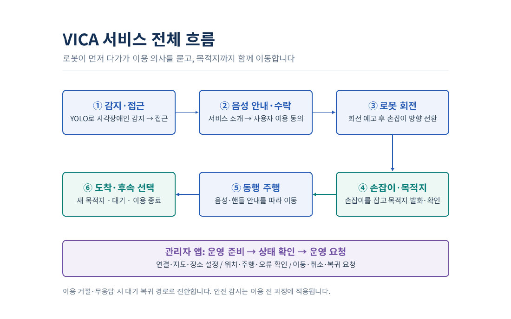
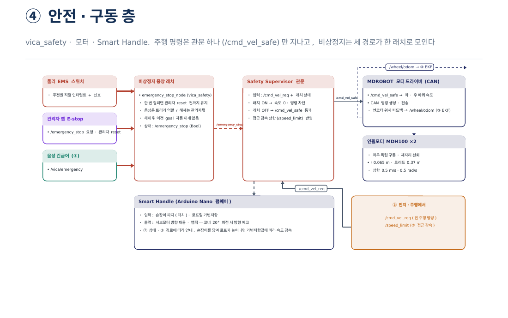
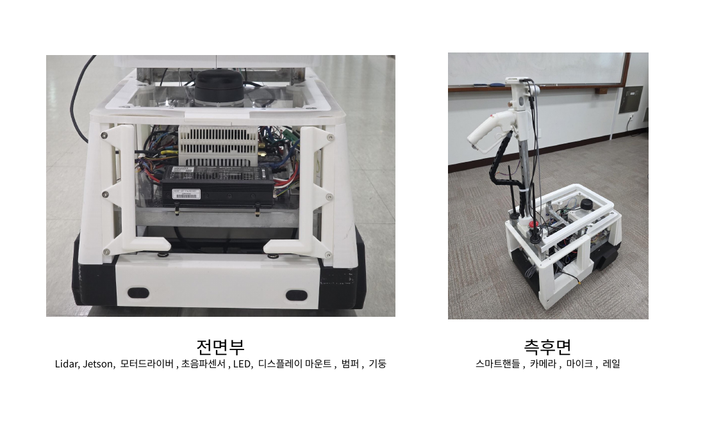
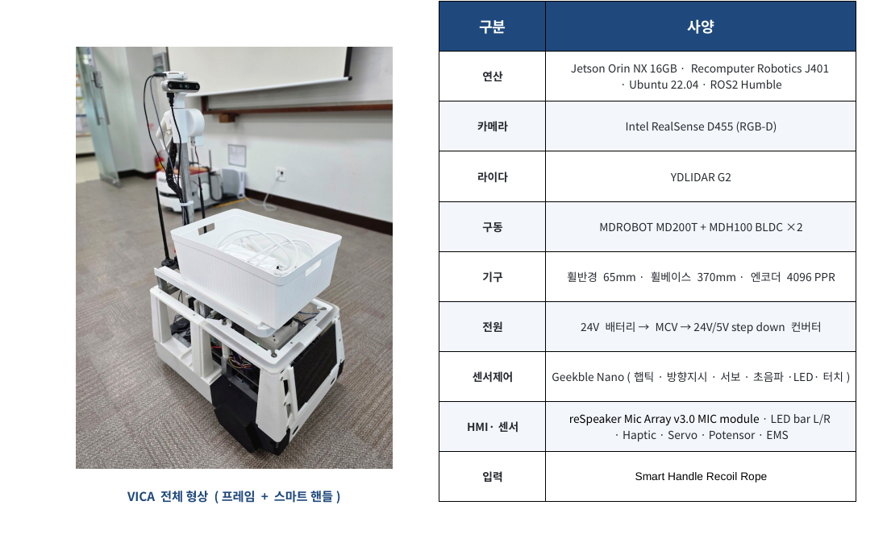
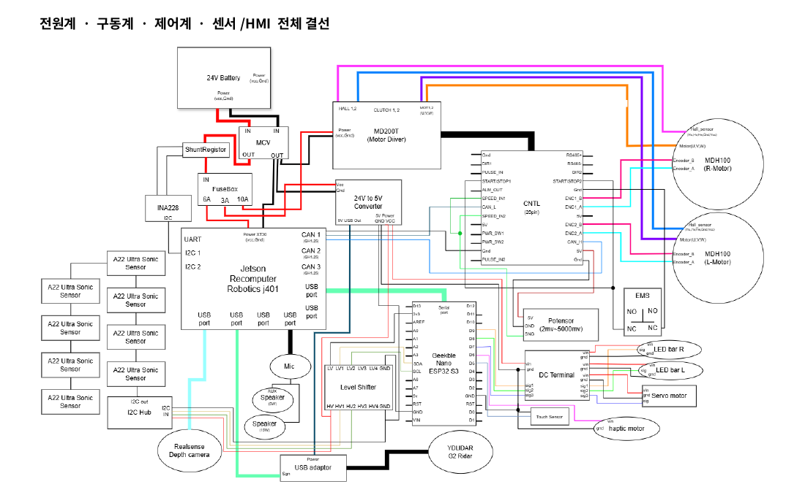
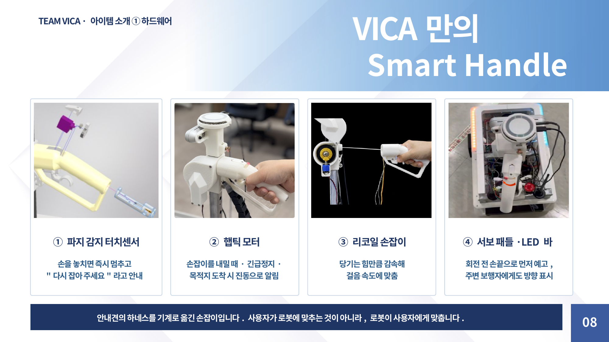
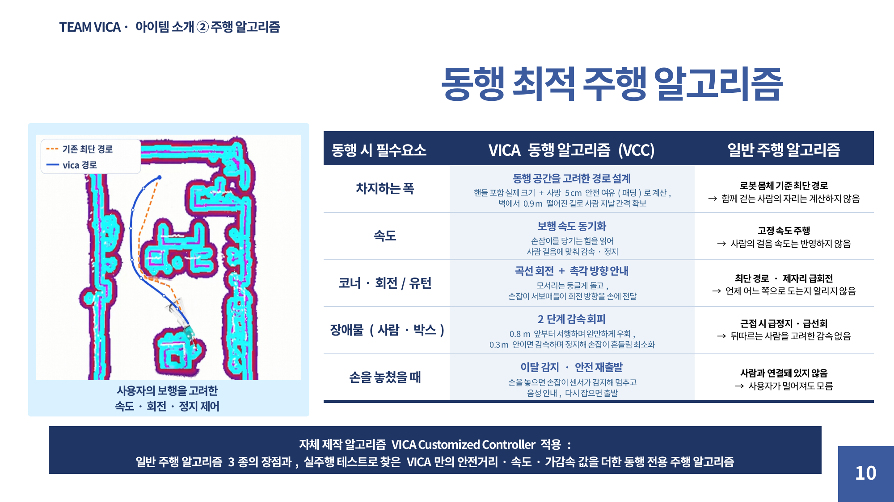
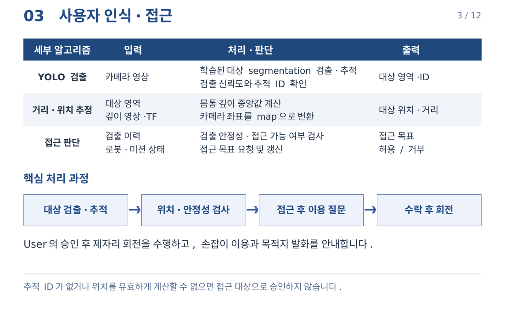

<div align="center">
  
  <h1>VICA</h1>
  <p><strong>Vision Companion · 손잡이를 잡고 함께 걷는 실내 전용 동행 로봇</strong></p>
  <p>'Smart Handle'과 LLM을 적용한 시각장애인 동행 AMR. 음성으로 목적지를 말하면, 손잡이를 잡은 채 목적지까지 함께 걷습니다.</p>
  <p>
    <a href="#overview">프로젝트 개요</a> ·
    <a href="#team">팀원 소개</a> ·
    <a href="#system">시스템 아키텍처</a> ·
    <a href="#video">작품 소개영상</a> ·
    <a href="#source">핵심 소스코드</a>
  </p>
  <p>
    
    
    
  </p>
</div>

---

<a id="overview"></a>
## **1. 프로젝트 개요**

**1-1. 프로젝트 소개**
- 프로젝트 명 : VICA(Vision Companion), 'Smart Handle'과 LLM을 적용한 시각장애인 동행 AMR
- 프로젝트 정의 : 사용자가 목적지까지 쉽게 이동할 수 있도록 돕는 동행형 실내 안내 AMR

<!-- 비카 이미지 들어갈 곳(비카에 대한 설명까지 이미지로 설명할 수 있으면 좋음) -->

**1-2. 개발 배경 및 필요성**
- **안내 수단 부족:** 함께 걷는 안내 수단은 사실상 안내견뿐인데, 공급이 턱없이 부족합니다. 국내 시각장애인은 약 24.4만 명이지만 시각장애인 대 안내견 비율은 2,711 : 1입니다.
- **시각 중심 안내:** 병원·복지관·도서관 같은 시설의 안내는 점자표지판, 키오스크, 안내로봇처럼 눈으로 보고 따라가야 하는 방식이 대부분입니다.

> 💡 **VICA의 해결**<br>
> 음성, 손잡이 촉각 피드백, 자율주행, 객체 인식을 묶어서 화면을 보지 않고도 목적지까지 함께 동행할 수 있게 합니다.

**1-3. 프로젝트 특장점**

| 특장점 | 내용 | 자세히 |
|---|---|:---:|
| 자체 제작 하드웨어 | 프레임과 손잡이를 직접 설계·제작하고, 5개 모듈로 나눠 고장 나면 모듈째 교체 | [3-2](#arch-hw) |
| Smart Handle | 당기는 만큼 감속하고, 회전 방향을 손끝으로 미리 알리는 똑똑한 손잡이 | [3-3](#arch-handle) |
| 동행 전용 주행 (VCC) | 손잡이와 사람의 자리까지 계산해서 장애물을 부드럽게 피하고 미리 감속 | [3-4](#arch-nav) |
| 온디바이스 음성·LLM | STT, LLM, TTS를 모두 로봇 안에서 처리해서 대화 내용이 밖으로 나가지 않음 | [3-5](#arch-voice) |
| 관리자 앱 | 지도 작성부터 원격 주행, 배송, 진단까지 앱 하나로 관리 | [3-6](#arch-app) |

**1-4. 주요 기능**

| 순서 | 기능 | 내용 |
|:---:|---|---|
| 1 | 사용자 인식·접근 | 카메라와 객체인식모델(YOLOv11n커스텀학습)로 시각장애인 지팡이를 든 사람을 인식하면 다가가 안내를 제안합니다 |
| 2 | 스마트핸들 | 사용자가 사용 의사를 표현하면 로봇을 회전시켜 스마트핸들을 내밀고, 진동으로 위치를 알립니다 |
| 3 | 자연어로 목적지 지정 | "화장실 가고 싶어", "배 아파"처럼 일상적인 표현을 추론해 등록된 장소와 연결하고, 목적지를 확인합니다 |
| 4 | 자율주행 | 관리자가 등록한 지도와 주행 레일을 따라 목적지까지 스스로 이동합니다. LiDAR·깊이 카메라·초음파로 장애물을 찾고, 직접 만든 동행 전용 컨트롤러(VCC)가 손잡이와 사람의 자리까지 계산해 부드럽게 피하고 코너 앞에서 미리 감속합니다 |
| 5 | 동행 주행 | 손잡이 당김을 감지해 사용자의 걸음속도에 맞춰 감속, 회전 방향을 디렉션 패들로 손끝으로 알리며 장애물을 우회주행합니다 |
| 상시 | 긴급 정지 | 대화 중이든 주행 중이든 긴급어를 상시 감시하고, LLM을 거치지 않고 바로 비상정지합니다 |
| 운영 | 관리자 앱 | 지도 작성, 목적지·홈·금지구역 등록, 원격 주행·배송, 비상정지, 로봇 상태 진단을 앱 하나로 관리합니다 |

**1-5. 기대 효과 및 활용 분야**
- 기대 효과 : 시각장애인이 누군가에게 안내를 부탁하지 않고 혼자 낯선 실내 시설을 이용할 수 있습니다. 안내 인력의 단순 동행 업무를 대신하고, 로컬 LLM 사용으로 클라우드 API 사용료와 통신료가 들지 않습니다.
- 활용 분야 : 요양·재활병원, 노인·장애인복지관, 공공도서관·관공서·공공청사 같은 복합 실내 시설 도입. 이후 고령자 혹은 길 찾기가 어려운 누구나 쓸 수 있는 시설 안내로봇, 짐 운반·물류 보조로 확장할 수 있습니다.

**1-6. 기술 스택**

| 분야 | 기술 |
|---|---|
| 연산·OS | Jetson Orin NX 16GB (reComputer J401) · Ubuntu 22.04 / JetPack 6.2 · CUDA |
| 미들웨어·주행 | ROS 2 Humble · Nav2 (Route Server, SmacPlannerLattice, 자체 컨트롤러 VCC) · Cartographer · AMCL · robot_localization(EKF) |
| 인지 | Intel RealSense D455 · YDLIDAR G2 · 초음파 · YOLO11s-seg(자체 데이터셋) + ByteTrack · TensorRT FP16 · Isaac ROS |
| 음성·LLM | reSpeaker Mic Array v3.0 · openWakeWord(자체 학습 2종) · Qwen3-ASR 1.7B(transcribe.cpp) · KT Mi:dm 2.0 Mini(Ollama) · LangChain · Supertonic-3 · CosyVoice 3 |
| 구동·하드웨어 | MDROBOT MD200T(CAN) + MDH100 인휠모터 ×2 · Smart Handle(로프릴·다회전 가변저항·서보·햅틱) · 24V LiFePO4 |
| 관리자 앱 | Flutter(Dart) · rosbridge WebSocket · Android |
| 시뮬레이션·도구 | Isaac Sim 6.0 · Docker · Foxglove Studio · RViz2 · Git/GitHub |

---

<a id="team"></a>
## **2. 팀원 소개(이름 기재X)**

| 🛠️ | 🧭 | 🎙️ | 📱 | 👨‍🏫 |
|:---:|:---:|:---:|:---:|:---:|
| **멘티1** | **멘티2** | **멘티3** | **멘티4** | **멘토** |
| • 하드웨어 설계·제작 <br> • 전장(전원·배선) | • 자율주행 <br> • 안전 제어 | • 음성 인터페이스 <br> • LLM | • 관리자 앱 | • 프로젝트 멘토 <br> • 기술 자문 |

---

<a id="system"></a>
## **3. 시스템 아키텍처**

| 3-1 | 3-2 | 3-3 | 3-4 | 3-5 | 3-6 | 3-7 |
|:---:|:---:|:---:|:---:|:---:|:---:|:---:|
| [전체 구성도](#arch-overall) | [하드웨어](#arch-hw) | [스마트 핸들](#arch-handle) | [자율주행](#arch-nav) | [음성 서비스](#arch-voice) | [관리자 앱](#arch-app) | [객체 인식](#arch-vision) |

<a id="arch-overall"></a>
### 3-1. 시스템 구성도



- **명령 흐름** : 음성 → 판단 → 주행 → 안전·구동 순서로 전달
- **미션 매니저** : 모든 요청을 10가지 조건으로 확인 후 주행 허가
- **안전 관문** : 버튼·앱·음성 비상정지를 한곳에서 관리, 관리자 확인 후에만 재출발



<details>
<summary>미션 매니저·안전 제어 상세 구성도</summary>




</details>

<a id="arch-hw"></a>
### 3-2. 하드웨어 구성




| 구성 | 부품 |
|:---:|---|
| 연산 | Jetson Orin NX 16GB (reComputer J401) |
| 센서 | YDLIDAR G2, Intel RealSense D455, 초음파 센서(A22), reSpeaker Mic Array v3.0, 전류 센서(INA228) |
| 구동 | MDROBOT MD200T 모터 드라이버(CAN) + MDH100 인휠모터 ×2 |
| Smart Handle | 로프릴·다회전 가변저항, 서보 패들, 햅틱 모터, 터치센서, LED 바, 센서·핸들 제어 MCU |
| 전원·안전 | 24V LiFePO4 배터리, DC 차단기, 24V→5V 컨버터, EMS 비상정지 스위치 |

- **자체 제작** : 프레임·하우징·손잡이 직접 설계
- **모듈 구조** : 손잡이·센서·컴퓨터·배터리·구동 5개 모듈, 고장 시 모듈 단위 교체

<details>
<summary>전체 결선도</summary>



</details>

<a id="arch-handle"></a>
### 3-3. 스마트 핸들



안내견 하네스에서 착안, 로봇이 사용자 걸음에 맞추는 손잡이

- **리코일 손잡이** : 당기는 만큼 감속, 끝까지 당기면 정지
- **서보 패들·LED 바** : 회전 전 방향 미리 알림
- **햅틱 모터** : 손잡이 위치·비상정지·도착을 진동으로 알림
- **터치센서** : 손을 놓으면 즉시 정지

<a id="arch-nav"></a>
### 3-4. 자율주행



- **위치 추정** : 바퀴·IMU 센서 융합과 지도 매칭으로 현재 위치 계산
- **경로** : 관리자가 그린 주행 레일을 따라 이동, 막힌 구간만 우회
- **동행 전용 컨트롤러(VCC)** : 손잡이까지 포함한 크기로 계산, 장애물 부드럽게 회피, 코너 앞 미리 감속
- **장애물 인식** : 라이다·깊이 카메라·초음파가 높이별로 나눠 감지

<details>
<summary>인지·위치·주행 상세 구성도</summary>


</details>

<a id="arch-voice"></a>
### 3-5. 음성 서비스


- **호출어·긴급어** : "비카야"·"멈춰" 상시 감지, 긴급어는 LLM 없이 즉시 정지
- **온디바이스 처리** : 음성 인식·LLM·음성 합성 모두 로봇 안에서 처리, 대화 내용 외부 전송 없음
- **안전한 LLM** : LLM은 목적지 제안만, 출발 결정은 미션 매니저
- **응답 속도** : 음성 인식 0.53초, LLM 판단 1.81초 (2026년 10월 실주행 중앙값)

<a id="arch-app"></a>
### 3-6. 관리자 앱


- **지도 설정** : 지도 작성, 목적지·홈·금지구역·주행 레일 지정
- **주행 관리** : 원격 주행·배송·비상정지, 부품별 상태 진단
- **알림** : 주행 실패·도움 요청 팝업, 배송 도착 문자
- **안전** : 앱 요청도 미션 매니저 확인 후 실행

<a id="arch-vision"></a>
### 3-7. 객체 인식 및 추적



- **자체 학습 모델** : 흰지팡이를 든 사람 데이터셋 직접 구축, YOLO11s-seg 학습
- **추적** : 같은 사람은 같은 ID로 추적, 깊이 카메라로 거리·위치 계산
- **접근** : 1.5~4 m 거리에 서 있는 사람에게 다가가 안내 제안
- **성능** : 로봇 시점 재학습으로 정밀도 0.513 → 0.998, 재현율 0.716 → 0.964, 초당 61.4회 인식

---

<a id="video"></a>
## **4. 작품 소개영상**

> 🎬 **YouTube 작품 소개영상**
> VICA가 사용자와 손잡이로 연결된 채 함께 걷는 자율주행과, 호출어 "비카야" → LLM 목적지·의도 해석 → 음성 안내로 이어지는 음성 목적지 입력을 실제 로봇으로 시연한 영상입니다.

[](https://www.youtube.com/watch?v=teIxBrbtmoQ)

▶️ 썸네일을 클릭하면 유튜브에서 영상이 재생됩니다.

---

<a id="source"></a>
## **5. 핵심 소스코드**

**저장소 구성**

| 폴더 | 내용 |
|---|---|
| `vica_ros2_ws/` | ROS 2 워크스페이스. 자율주행, 미션 매니저, 안전 제어, 모터, Smart Handle, 사람 인식 |
| `vica-voice-llm/` | 음성 인터페이스. 호출어·긴급어 감지, STT, LLM 의도 해석, TTS |
| `VICA_Supervisor/` | Flutter 관리자 앱 |

**코드 목록** (3장 시스템 아키텍처와 같은 순서)

| No. | 분류 | 기능 | 파일 | 언어 |
|:---:|---|---|---|:---:|
| 5-1 | 전체 시스템 | 미션 매니저 상태 관리 | [`mission_logic.py`](vica_ros2_ws/src/vica_mission_manager/vica_mission_manager/mission_logic.py) | Python |
| 5-2 | 전체 시스템 | 안전 관문 (Safety Gate) | [`safety_gate.py`](vica_ros2_ws/src/vica_safety/vica_safety/safety_gate.py) | Python |
| 5-3 | 하드웨어 | 모터 드라이버 CAN 제어 | [`motor_core.hpp`](vica_ros2_ws/src/mdrobot_can_control_cpp/include/mdrobot_can_control_cpp/motor_core.hpp) | C++ |
| 5-4 | 스마트 핸들 | 가변저항 속도 조절 | [`motor_core.hpp`](vica_ros2_ws/src/mdrobot_can_control_cpp/include/mdrobot_can_control_cpp/motor_core.hpp) | C++ |
| 5-5 | 자율주행 | ① 장애물을 피하는 차선 선택 | [`lanes.cpp`](vica_ros2_ws/src/vica_vcc_controller/src/core/lanes.cpp) | C++ |
| 5-6 | 자율주행 | ② 코너·장애물 앞 미리 감속 | [`speed_profile.cpp`](vica_ros2_ws/src/vica_vcc_controller/src/core/speed_profile.cpp) | C++ |
| 5-7 | 자율주행 | ③ 충돌 예측 정지 | [`vcc_core.cpp`](vica_ros2_ws/src/vica_vcc_controller/src/core/vcc_core.cpp) | C++ |
| 5-8 | 음성 서비스 | STT → LLM → TTS | [`ros_node.py`](vica-voice-llm/src/ros_node.py) | Python |
| 5-9 | 관리자 앱 | 주행·도움 요청 알림 | [`supervisor_provider.dart`](VICA_Supervisor/lib/providers/supervisor_provider.dart) | Dart |
| 5-10 | 객체 인식 | 사람 인식 및 추적 | [`person_detector_node.py`](vica_ros2_ws/src/vica_perception/vica_perception/person_detector_node.py) | Python |

<br>

### 5-1. 전체 시스템 ① 미션 매니저 상태 관리

📄 [`vica_ros2_ws/src/vica_mission_manager/vica_mission_manager/mission_logic.py`](vica_ros2_ws/src/vica_mission_manager/vica_mission_manager/mission_logic.py)

음성, 관리자 앱, 사람 인식에서 오는 요청은 모두 미션 매니저를 거칩니다. 로봇의 상태(18개)에 따라 같은 말에도 다르게 반응하고, 목적지로 출발하기 전에는 `check_gate()` 로 10가지 조건(목적지 확정, 사용자 확인, 비상정지, 좌표, Nav2 준비 등)을 확인합니다.

```python
if intent.need_confirm:
    # ...
    self.state = State.CONFIRMING  # "OO로 안내해드릴까요?" 대답 기다림
    self._confirm_from_approach = False
    self._confirming_dest_id = intent.matched_destination_id or None
    self._arm_confirm(now)
    self._confirm_prompt = self._confirm_prompt_for(dest)
    return []

# ...
reason = check_gate(intent, dest, bounds, self.estop_active, nav_ready)
if reason != GateReason.OK:
    folded: list = []
    # ...
    msg = _REJECT_MESSAGES.get(reason)
    return ([Say(msg, priority="response")] if msg else []) + folded

# ...
self.state = State.NAVIGATING
self.active_destination = dest
# ...
return [
    SetNavSpeedLimit(NO_SPEED_LIMIT),
    Say(say_destination(MSG_START, dest.name)),
    Navigate(dest, tree=NAV_TREE_GUIDED),
]
```

- 로봇을 직접 움직이지 않고 할 일 목록만 돌려주는 구조라서, ROS 없이도 18개 상태 × 11개 요청 = 198가지 경우를 테스트로 확인했습니다.

<br>

### 5-2. 전체 시스템 ② 안전 관문 (Safety Gate)

📄 [`vica_ros2_ws/src/vica_safety/vica_safety/safety_gate.py`](vica_ros2_ws/src/vica_safety/vica_safety/safety_gate.py)

모든 주행 명령은 이 관문을 지나야 모터로 갑니다. 버튼, 앱, 음성("멈춰") 비상정지는 하나로 모이고, 비상정지가 풀려도 관리자가 앱에서 다시 시작을 눌러야만 움직입니다.

```python
def state_for_command(self, estop_active, estop_fresh, cmd_alive, cmd_zero) -> SafetyState:
    previous = self.state
    if not estop_fresh:  # 비상정지 신호가 끊기면 고장으로 본다
        self.reset_armed = False
        self.state = SafetyState.FAULT
        return self.state
    if estop_active:
        self.reset_armed = False
        self.state = SafetyState.ESTOP_ACTIVE
        return self.state
    if not self.reset_armed:  # 관리자가 reset 하기 전까지 대기
        if previous in (SafetyState.ESTOP_ACTIVE, SafetyState.FAULT):
            self.state = SafetyState.ESTOP_RELEASED_WAIT_RESET
        elif previous is not SafetyState.ESTOP_RELEASED_WAIT_RESET:
            self.state = SafetyState.IDLE
        return self.state
    if not cmd_alive or cmd_zero:
        self.state = SafetyState.READY_TO_GO
        return self.state
    self.state = SafetyState.RUNNING  # 이 상태에서만 명령을 보낸다
    return self.state
```

<br>

### 5-3. 하드웨어 · 모터 드라이버 CAN 제어

📄 [`vica_ros2_ws/src/mdrobot_can_control_cpp/include/mdrobot_can_control_cpp/motor_core.hpp`](vica_ros2_ws/src/mdrobot_can_control_cpp/include/mdrobot_can_control_cpp/motor_core.hpp)

안전 관문을 통과한 속도 명령(`/cmd_vel_safe`)을 좌우 바퀴의 rpm으로 바꿔 MDROBOT MD200T 드라이버에 CAN으로 보냅니다. 두 바퀴 속도는 8바이트 프레임 하나에 같이 담습니다. 최고 속도는 그 전에 손잡이 값으로 먼저 제한됩니다(5-4).

```cpp
// 전진·회전 속도 → 좌우 바퀴 속도
const double v_left = limited_linear_x - limited_angular_z * p.wheel_base_m / 2.0;
const double v_right = limited_linear_x + limited_angular_z * p.wheel_base_m / 2.0;

double rpm_mot1_f = mps_to_rpm(v_right);  // MOT1 = 오른쪽
double rpm_mot2_f = mps_to_rpm(v_left);   // MOT2 = 왼쪽
// ...
int64_t rpm_mot1 = py_round(clampd(rpm_mot1_f, -max_rpm, max_rpm));
int64_t rpm_mot2 = py_round(clampd(rpm_mot2_f, -max_rpm, max_rpm));

// 값이 바뀌었거나 재전송 시간이 됐을 때만 보낸다
if (prev_rpm_mot1 != rpm_mot1 || prev_rpm_mot2 != rpm_mot2 || resend_due) {
  send_vel_cmd(rpm_mot1, rpm_mot2, RET_TYPE_ODOM);
  // ...
}

void send_vel_cmd(int64_t rpm1, int64_t rpm2, int ret_type)
{
  // ...
  const auto [lo1, hi1] = le_i16_signed(rpm1);
  const auto [lo2, hi2] = le_i16_signed(rpm2);
  Frame f;
  f.id = static_cast<uint32_t>(p.driver_id);
  f.dlc = 8;
  f.data = {PID_PNT_VEL_CMD, 1, lo1, hi1, 1, lo2, hi2, static_cast<uint8_t>(ret_type & 0xFF)};
  // ...
  io.send(f);
}
```

- Python으로 먼저 만든 뒤 C++로 옮겼습니다. 옮기고 나서 같은 입력 36만 개에서 두 버전이 보내는 CAN 프레임이 똑같은지 비교했습니다.

<br>

### 5-4. 스마트 핸들 · 가변저항 속도 조절

📄 [`vica_ros2_ws/src/mdrobot_can_control_cpp/include/mdrobot_can_control_cpp/motor_core.hpp`](vica_ros2_ws/src/mdrobot_can_control_cpp/include/mdrobot_can_control_cpp/motor_core.hpp)

손잡이 줄은 로프릴 안의 다회전 가변저항과 연결되어 있습니다. 줄을 당기면 저항값이 바뀌고, 모터 드라이버가 이 값을 0~100 %로 보내 줍니다. 이 비율만큼 최고 속도를 낮추기 때문에 사용자가 당기면 로봇이 느려지고, 끝까지 당기면 멈춥니다.

```cpp
// 줄이 실제로 움직이는 구간(55~98)을 0~100 %로 늘린다
inline int64_t normalize_knob_pct(int64_t raw_pct, int64_t min_pct, int64_t max_pct)
{
  if (max_pct <= min_pct) {
    return raw_pct;
  }
  const int64_t scaled = py_round(
    sub_to_double(raw_pct, min_pct) * 100.0 / sub_to_double(max_pct, min_pct));
  return std::max<int64_t>(0, std::min<int64_t>(100, scaled));
}

inline double motor_speed_ratio(/* ... */)
{
  // ...
  if (!cmd_fresh || !knob_fresh) {
    return 0.0;  // 주행 명령이나 손잡이 신호가 끊기면 정지
  }
  if (knob_pct <= deadzone_pct) {
    return 0.0;
  }
  return static_cast<double>(knob_pct) / 100.0;
}

// control_loop()
const double allowed_linear = p.max_linear_mps * speed_ratio;
const double allowed_angular = p.max_angular_radps * speed_ratio;
const double limited_linear_x = clampd(raw_linear_x, -allowed_linear, allowed_linear);
const double limited_angular_z = clampd(raw_angular_z, -allowed_angular, allowed_angular);
```

- 처음에는 0~100을 그대로 썼는데, 실제 줄은 55~98 구간에서만 움직여서 당겨도 속도가 거의 바뀌지 않았습니다. 이 구간을 0~100 %로 다시 늘려서 해결했습니다.

<br>

### 5-5. 자율주행 ① 장애물을 피하는 차선 선택

📄 [`vica_ros2_ws/src/vica_vcc_controller/src/core/lanes.cpp`](vica_ros2_ws/src/vica_vcc_controller/src/core/lanes.cpp)

VICA는 손잡이로 사람과 연결되어 있어서, 장애물 앞에서 급하게 꺾으면 사람이 그대로 끌려갑니다. 그래서 직접 만든 컨트롤러(VCC)는 주행 레일을 좌우로 0.1 m씩 옮긴 13개 차선(±0.6 m)을 만들고, 매 주기 점수가 가장 낮은 차선으로 부드럽게 옮겨 갑니다.

```cpp
// 오른쪽 차선부터 점수를 매긴다 (점수가 같으면 우측 통행)
for (int i = -n; i <= n; ++i) {scores_.push_back(evaluate(path, v_des, i * p_.step, f));}

// evaluate(): 장애물과의 거리 > 레일과의 거리 > 차선 변경 폭 순으로 중요
sc.score = p_.w_clear * std::max(0.0, p_.target_clearance - sc.min_clearance) +
  p_.w_rail * std::abs(cand) + p_.w_change * std::abs(cand - target_);

// 지금 차선이 막히면 바로 옮기고, 아니면 더 좋은 차선이 몇 주기 이어질 때만 옮긴다
if (!cur || !cur->valid) {
  target_ = best->offset;
  pending_count_ = 0;
} else if (!same(best->offset, target_) && best->score < cur->score - p_.switch_margin) {
  // ...
}

// 옆으로 움직이는 속도는 lane_rate 를 넘지 않게
const double slope = p_.lane_rate / std::max(target_speed_, 1e-3);
const double step = std::min(slope * std::abs(v) * dt, p_.lane_rate * dt);
offset_ += std::clamp(target_ - offset_, -step, step);
```

- 점수는 `10 × (장애물과 20 cm 거리에 모자란 만큼) + 1 × (레일에서 벗어난 거리) + 0.5 × (차선을 바꾸는 폭)` 입니다.
- 차선을 너무 자주 바꾸면 손잡이가 좌우로 흔들려서, 막혔을 때가 아니면 바로 바꾸지 않습니다.

<br>

### 5-6. 자율주행 ② 코너·장애물 앞 미리 감속

📄 [`vica_ros2_ws/src/vica_vcc_controller/src/core/speed_profile.cpp`](vica_ros2_ws/src/vica_vcc_controller/src/core/speed_profile.cpp)

코너에 들어간 뒤에 속도를 줄이면 뒤따르는 사람이 덜컹거림을 그대로 느낍니다. 그래서 앞 1.5 m 경로를 미리 보고, 코너나 장애물이 있으면 닿기 전에 속도를 줄입니다.

```cpp
// 회전 반지름이 작을수록 느리게
double curveLimitAt(double k, const SpeedParams & p)
{
  const double r = 1.0 / std::max(std::abs(k), 1e-6);
  if (r >= p.curve_min_radius) {return p.desired;}
  return std::max(p.min_speed, p.desired * r / p.curve_min_radius);
}

// curvePreviewLimit(): 경로 위 세 점으로 곡률을 구하고,
// 코너까지 남은 거리 안에서 감속할 수 있는 속도를 상한으로 둔다
const double k = 2.0 * std::abs(ax * by - ay * bx) / (la * lb * lc);
const double vl = curveLimitAt(k, p);
limit = std::min(limit, std::sqrt(vl * vl + 2.0 * p.curve_decel * s[j - 1]));

// 장애물과 가까울수록 느리게
double clearanceLimit(double c, const SpeedParams & p)
{
  if (c >= p.slow_clearance) {return p.desired;}
  return std::max(p.min_speed, p.desired * std::max(c, 0.0) / p.slow_clearance);
}
```

- 회전 반지름 0.8 m보다 급한 코너, 장애물과 0.35 m보다 가까운 구간에서 속도가 줄어듭니다.
- `sqrt(v² + 2·a·d)` 는 "지금부터 감속하면 코너에서 목표 속도가 되는 최대 속도"입니다.

<br>

### 5-7. 자율주행 ③ 충돌 예측 정지

📄 [`vica_ros2_ws/src/vica_vcc_controller/src/core/vcc_core.cpp`](vica_ros2_ws/src/vica_vcc_controller/src/core/vcc_core.cpp)

지금 속도로 멈추는 데 필요한 거리만큼 앞 경로에 로봇을 미리 놓아 보고, 손잡이를 포함한 몸이 장애물에 닿으면 바로 멈춥니다. `clearance()` 는 장애물 지도(costmap)와 초음파 값을 함께 봅니다.

```cpp
bool imminent = false;
if (sm_.state() == State::Track && v > p_.stationary_speed) {
  // 정지거리 = 제동 거리 + 반응 지연 동안 가는 거리 + 여유
  const double s_stop = v * v / (2.0 * p_.output.max_decel) + v * p_.stop_latency + p_.stop_margin;
  for (const auto & ps : pathPrefix(lane_path, s_stop)) {
    if (in.clearance(ps) < 0.0) {imminent = true; break;}
  }
}
// ...
si.collision_imminent = imminent;
```

<br>

### 5-8. 음성 서비스 · STT → LLM → TTS

📄 [`vica-voice-llm/src/ros_node.py`](vica-voice-llm/src/ros_node.py)

"비카야"라고 부른 뒤 한 말은 Qwen3-ASR이 글자로 바꿔 이 함수로 들어옵니다. 긴급어가 있으면 바로 긴급 처리하고, 나머지는 로컬 LLM(Mi:dm 2.0 Mini)이 의도와 목적지를 고릅니다. LLM의 결과는 로봇을 직접 움직이지 않고, 미션 매니저에 요청으로만 전달됩니다.

```python
def _on_user_text(self, msg: String) -> None:
    text = msg.data.strip()
    # ...
    keyword = detect_emergency(text)
    if keyword:  # 긴급어는 LLM을 거치지 않는다
        intent = VicaIntent(
            intent="unknown",
            reply="",
            need_confirm=False,
            safety_flag="emergency",
        )
    else:
        thinking = not is_instant_utterance(text)
        if thinking:
            self._thinking_pub.publish(Bool(data=True))  # 기다리는 동안 효과음
        try:
            intent = parse_intent(
                text,
                self._destinations,
                history=self._history.messages,
                robot_state=self._robot_state,
                situation=self._situation_block(),
            )
        finally:
            if thinking:
                self._thinking_pub.publish(Bool(data=False))
    self._publish_intent(intent, text)


def _publish_intent(self, intent: VicaIntent, text: str, llm_first: bool = False) -> None:
    # ...
    if should_forward_intent(intent):
        self._intent_pub.publish(intent_to_msg(intent))  # → 미션 매니저
    request = request_for_intent(intent)
    if request:
        self._tts_pub.publish(String(data=request))      # → TTS
    if (intent.need_confirm or intent.intent == "clarify"
            or expects_answer(intent.reply)):
        self._listen_pub.publish(Bool(data=True))        # 대답 들을 준비
```

- STT, LLM, TTS가 모두 로봇 안에서 돌아가서 목소리와 대화 내용이 외부로 나가지 않고, 인터넷이 끊겨도 동작합니다.
- "그래", "아니" 같은 짧은 대답은 LLM 없이 바로 처리해서 기다리는 시간이 없습니다.

<br>

### 5-9. 관리자 앱 · 주행·도움 요청 알림

📄 [`VICA_Supervisor/lib/providers/supervisor_provider.dart`](VICA_Supervisor/lib/providers/supervisor_provider.dart)

로봇이 보내는 주행 이벤트(출발, 도착, 실패, 취소, 도움 요청)를 받아 관리자에게 알립니다. 사용자의 도움 요청은 주행 알림과 섞이지 않게 따로 띄우고, 배송이 끝나면 문자로도 알려 줍니다.

```dart
void _handleGoalEvent(Map<String, Object?> message) {
  final event = GoalEvent.fromJson(message, id: _uuid.v4());

  if (event.isHelp) {  // 도움 요청은 별도 팝업
    _applyHelpEvent(event);
    notifyListeners();
    return;
  }
  // ...
  if (event.kind == GoalEventKind.succeeded &&
      event.delivery &&
      !_isMyDeliveryArrival(event)) {
    unawaited(_relayDeliverySms(event));  // 배송 도착 문자
  }
  // ...
  if (event.needsPopup) {
    // 비상정지 중의 취소는 같은 사건이라 팝업을 또 띄우지 않는다
    final hiddenByEmergency = event.kind == GoalEventKind.canceled &&
        _emergencyStopState == EmergencyStopState.active;
    if (!hiddenByEmergency) {
      _pendingGoalAlert = event;
      // ...
    }
    // ...
    _addLog(
      event.isFailure
          ? LogFilter.emergencyStop
          : LogFilter.coordinateTransfer,
      '$where${event.title}$detail',
    );
  }
  notifyListeners();
}
```

- 알림이 너무 많으면 관리자가 읽지 않고 닫게 됩니다. 그래서 성공은 기록만 남기고, 같은 사건은 한 번만 띄웁니다.

<br>

### 5-10. 객체 인식 및 추적 · 시각장애인 찾기

📄 [`vica_ros2_ws/src/vica_perception/vica_perception/person_detector_node.py`](vica_ros2_ws/src/vica_perception/vica_perception/person_detector_node.py)

흰지팡이를 든 사람을 직접 모은 데이터로 학습한 YOLO11s-seg 모델을 TensorRT로 돌립니다. 같은 사람은 계속 같은 ID로 따라가고, 1초 넘게 안정적으로 보이면서 3초 동안 1.5~4 m 거리에 서 있으면 미션 매니저에 다가가도 되는지 요청합니다.

```python
if not self._infer_gate.should_infer(now_ns):  # 주행 중에는 추론하지 않음
    return
# ...
result = self._model.track(
    img, device=0, conf=self._conf, persist=True, verbose=False)[0]
# ...
for i in range(len(boxes)):
    bbox = tuple(float(v) for v in boxes.xyxy[i].tolist())
    conf = float(boxes.conf[i])
    track_id = int(ids[i]) if ids is not None else PersonDetection.TRACK_ID_NONE

    # 몸통 영역의 깊이 중앙값으로 거리를 재고 지도 좌표로 바꾼다
    dist_m, map_pt = self._locate(bbox, depth_m, depth_info, msg)
    # ...
    if (track_id != PersonDetection.TRACK_ID_NONE
            and map_pt is not None and math.isfinite(dist_m)):
        verdict = self._gate.observe(DetectionSample(
            stamp_ns=steady_ns,
            track_id=track_id,
            confidence=conf,
            position=Point2D(map_pt[0], map_pt[1]),
            distance_m=dist_m,
        ))
        out.stable = verdict.stable
        out.approachable = verdict.approachable

    self._pub.publish(out)

    if out.approachable and self._throttle.should_send(track_id, steady_ns):
        self._request_approach(out)
```

- 주행 중에는 추론을 멈춰서 Jetson의 CPU를 주행에 양보합니다.
